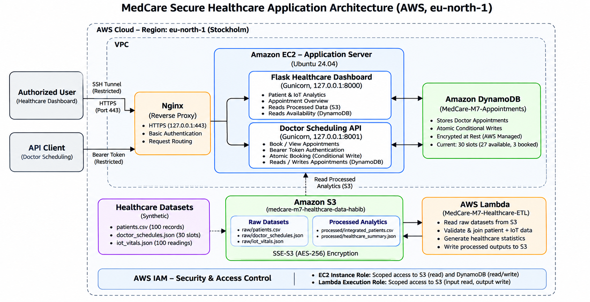

# MedCare — Secure Healthcare Application and Analytics Platform

**BCA Cloud Computing | Modular Assignment 7**  
**AWS Region:** Europe (Stockholm), `eu-north-1`  
**Project type:** Academic demonstration using **synthetic healthcare data**

## Project overview

MedCare is a cloud-hosted healthcare demonstration combining patient and simulated IoT-vitals analytics with a doctor appointment scheduling API. Amazon S3 stores source and processed datasets; AWS Lambda performs healthcare ETL; an Ubuntu EC2 instance hosts two Flask services behind Nginx; and Amazon DynamoDB persists appointments and prevents double booking.

The dashboard reads processed analytics from S3 and checks current appointment availability in DynamoDB. The Lambda-generated summary is a **point-in-time dataset snapshot**; current booking counts are obtained from DynamoDB when the dashboard is requested.

## Architecture



**Implemented components**

| Component | Purpose |
|---|---|
| Amazon EC2 (Ubuntu 24.04) | Runs dashboard and scheduling API using Gunicorn and systemd |
| Nginx | Localhost HTTPS reverse proxy with Basic Authentication for dashboard access |
| Amazon S3 | Stores raw healthcare inputs and processed analytics; SSE-S3 (`AES256`) |
| AWS Lambda (Python 3.13) | Validates and integrates S3 healthcare data; writes processed outputs |
| Amazon DynamoDB | Stores appointment bookings and enforces conditional writes |
| AWS IAM | Scopes EC2 access to required S3/DynamoDB operations and Lambda access to S3 input/output objects |

**Access boundary:** The HTTPS endpoint is bound to `127.0.0.1:443` on EC2 and accessed through an SSH tunnel. Its certificate is self-signed, not publicly trusted. The Flask/Gunicorn services listen on `127.0.0.1:8000` (dashboard) and `127.0.0.1:8001` (API). This is **not** a public-facing production deployment.

## Repository structure

```text
MedCare-Healthcare-M7/
├── app/
│   ├── dashboard.py
│   └── doctor_api.py
├── data/
│   ├── raw/
│   │   ├── patients.csv
│   │   ├── doctor_schedules.json
│   │   └── iot_vitals.json
│   └── processed/
│       ├── integrated_patients.csv
│       └── healthcare_summary.json
├── deployment/
│   └── lambda/
│       └── lambda_function.py
├── docs/
│   ├── architecture/
│   │   └── MedCare-M7-Architecture.png
│   └── evidence/
│       └── E01–E11 screenshots
├── scripts/
│   ├── generate_datasets.py
│   └── integrate_healthcare_data.py
├── tests/
├── .gitignore
├── requirements.txt
└── README.md
```

The EC2 deployment additionally uses Nginx and systemd configuration. Capture and document the **actual deployed configuration** before treating the repository as a fully reproducible deployment; do not commit certificates, private keys, API tokens or passwords.

## Data integration and analytics

Three synthetic datasets are stored under the S3 `raw/` prefix:

- `patients.csv`: 100 patient records.
- `doctor_schedules.json`: 30 consultation slots across five doctors.
- `iot_vitals.json`: 100 simulated vital-sign readings.

The deployed Lambda function `MedCare-M7-Healthcare-ETL` reads these objects, checks for duplicate patient identifiers and unknown patient references, associates patient data with the latest vital readings, and writes:

- `processed/integrated_patients.csv`
- `processed/healthcare_summary.json`

The dashboard displays patient counts, diagnosis distribution, appointment activity, consultation availability and recent IoT readings. **Lambda does not query DynamoDB**; the dashboard and scheduling API query it directly for live booking state.

## Scheduling API

The Flask scheduling API supports:

| Method | Endpoint | Purpose | Authentication |
|---|---|---|---|
| `GET` | `/health` | Service health check | No bearer token; service is locally bound |
| `GET` | `/doctors` | List doctor schedules and current booking state | Bearer token |
| `GET` | `/doctors/<doctor_id>` | View one doctor's schedule | Bearer token |
| `POST` | `/appointments` | Validate and book an available consultation slot | Bearer token |

Example appointment request body:

```json
{
  "doctor_id": "D001",
  "slot": "2026-11-10T09:00:00",
  "patient_id": "<registered-synthetic-patient-id>"
}
```

The example illustrates the request format; the displayed slot may already be booked. Booking uses DynamoDB `PutItem` with `attribute_not_exists(booking_key)`, allowing one concurrent request to succeed and returning **HTTP 409** for competing requests to the same slot. Invalid inputs and unregistered patients are rejected.

## Security measures

- Restricted access through an SSH tunnel; Nginx listens on EC2 loopback HTTPS with a self-signed certificate.
- Nginx Basic Authentication for the dashboard; bearer-token checks for protected scheduling API endpoints.
- Dashboard and API Gunicorn processes bound to localhost.
- EC2 IAM role grants scoped S3 read and DynamoDB read/write permissions.
- Lambda execution role grants scoped S3 input read and processed-output write permissions; no DynamoDB access is claimed.
- S3 processed outputs use SSE-S3 (`AES256`); DynamoDB uses AWS-managed at-rest encryption.
- DynamoDB conditional writes protect against simultaneous double booking.
- No real patient information is used. The system is an academic demonstration, **not a HIPAA-certified service**.

## Deployment outline

1. Generate the synthetic datasets using `scripts/generate_datasets.py` and upload the three inputs to the S3 bucket `medcare-m7-healthcare-data-habib` under `raw/`.
2. Deploy `deployment/lambda/lambda_function.py` as the `MedCare-M7-Healthcare-ETL` function and run it with an S3-scoped execution role to create `processed/` objects.
3. Create DynamoDB table `MedCare-M7-Appointments` with partition key `booking_key` (String).
4. On an Ubuntu 24.04 EC2 instance, install Python dependencies, place the project at `/opt/medcare`, and configure the EC2 instance role for S3 reads and DynamoDB access.
5. Run the Flask applications through separate Gunicorn/systemd services on `127.0.0.1:8000` and `127.0.0.1:8001`.
6. Configure Nginx to reverse-proxy the dashboard and API, using localhost HTTPS, Basic Authentication and a self-signed localhost certificate. Keep authentication secrets out of source control.
7. Use an SSH local port forward to access the restricted HTTPS endpoint and perform functional, authorization, concurrency and recovery tests.

**Reproducibility note:** The source code is supplied, but production-style deployment requires the separately configured AWS resources, IAM policies, service definitions and Nginx settings. The self-signed certificate is appropriate only for the restricted academic test setup.

## Verification results

| Test | Observed result |
|---|---|
| Dataset integration | 100 synthetic patients, 100 simulated vital readings, 30 consultation slots |
| Appointment persistence | 27 available and 3 booked slots at final verification |
| Concurrent booking | Five competing requests: one HTTP 201; four HTTP 409 |
| Simulated workload | 30 requests, 10 workers, 30 successful, 0 failed (100% success) |
| Workload latency | 2.215 seconds average; 7.750 seconds total |
| Recovery | Services restarted successfully; three persisted bookings remained |
| Dashboard summary | Final verification passed |

The workload test demonstrates behavior under a **small simulated concurrent workload**; it does not establish AWS Auto Scaling, multi-AZ failover or production performance guarantees.

## Evidence gallery

| Evidence | Description |
|---|---|
| [E01](docs/evidence/E01-Doctor-Scheduling-API-Test.png) | Doctor Scheduling API test |
| [E02](docs/evidence/E02-Healthcare-Dashboard-Overview.png) | Dashboard overview |
| [E03](docs/evidence/E03-Healthcare-Dashboard-Monitoring.png) | Dashboard monitoring |
| [E04](docs/evidence/E04-S3-Healthcare-Bucket.png) | S3 bucket |
| [E05](docs/evidence/E05-S3-Healthcare-Datasets.png) | S3 datasets |
| [E06](docs/evidence/E06-Lambda-ETL-S3-Output.png) | Lambda ETL output |
| [E07](docs/evidence/E07-HTTPS-Authentication-Security.png) | Restricted HTTPS and authentication |
| [E08](docs/evidence/E08-DynamoDB-Appointment-Persistence.png) | DynamoDB booking persistence |
| [E09](docs/evidence/E09-Scalability-Workload-Test.png) | Simulated concurrent workload |
| [E10](docs/evidence/E10-Resilience-Recovery-Test.png) | Service recovery and persistence |
| [E11](docs/evidence/E11-Final-Dashboard-Verification.png) | Final dashboard verification |

## Academic scope

This repository demonstrates secure cloud application integration, serverless ETL, simulated IoT data analytics, persistent appointment scheduling and documented functional testing. All patient records and vital readings are synthetic. No public-facing deployment, automatic scaling, multi-region redundancy or regulatory certification is claimed.
